# 🍜 Zest & Savory — Food Delivery App

ระบบสั่งอาหารออนไลน์สำหรับร้านอาหาร พัฒนาด้วย **Flutter** (Frontend) + **Node.js/Express** (Backend) + **MySQL** (Database)

---

## ✨ App Features (ฟีเจอร์ทั้งหมด)

### 🔐 1. Authentication — ระบบเข้าสู่ระบบ

```
┌────────────────────────────────────────────────────────────┐
│  📱 กรอกเบอร์มือถือ  →  📨 รับ OTP  →  ✅ เข้าแอปได้เลย  │
└────────────────────────────────────────────────────────────┘
```

| ฟีเจอร์ | รายละเอียด |
|--------|-----------|
| **Phone OTP Login** | ล็อกอินผ่านเบอร์โทรศัพท์ด้วย Firebase Phone Auth |
| **OTP Screen** | กรอก OTP 6 หลัก พร้อม countdown resend timer |
| **Web Dev Mode** | Mock OTP สำหรับทดสอบบน Web โดยไม่ต้องใช้ Firebase จริง |
| **Auto Redirect** | หลังยืนยัน OTP สำเร็จ นำทางเข้าหน้าหลักทันที |

---

### 📊 2. Dashboard — ภาพรวมร้าน

```
┌─────────────────────────────────────────────────────┐
│  🏪 Store Header       🔔 Notification Bell         │
│─────────────────────────────────────────────────────│
│  Overview                                           │
│  Tuesday, April 30                                  │
│  ● Store Online                                     │
│─────────────────────────────────────────────────────│
│  ┌──────────────────────────────┐                   │
│  │ 💰 Today's Sales     +14.5% │                   │
│  │ ฿12,480.00                   │                   │
│  │ [██  ███ █  ██████  █████]   │  7-day chart      │
│  └──────────────────────────────┘                   │
│  ┌──────────────────────────────────────────────┐   │
│  │ 🧾 Active Orders           [View All]        │   │
│  │          12                                  │   │
│  │ Preparing: 8              Ready: 4           │   │
│  └──────────────────────────────────────────────┘   │
│  ┌──────────────────┐                               │
│  │ 🔥 Top Items      │                               │
│  │ 🍔 Classic Smash  │                               │
│  │ 🍕 Margherita     │                               │
│  └──────────────────┘                               │
└─────────────────────────────────────────────────────┘
```

| ฟีเจอร์ | รายละเอียด |
|--------|-----------|
| **Today's Sales** | ยอดขายรวมวันนี้ + กราฟแท่ง 7 วันย้อนหลัง |
| **Store Toggle** | กด pill เพื่อเปิด/ปิดร้านได้ทันที |
| **Active Orders** | นับ order ที่ยังรอดำเนินการ + ปุ่ม View All |
| **Top Items** | แสดงเมนูขายดีพร้อมรูปภาพ |
| **Pull to Refresh** | ดึงหน้าจอลงเพื่อโหลดข้อมูลใหม่ |

---

### 📋 3. Order Management — จัดการออเดอร์

```
Order Lifecycle:
─────────────────────────────────────────────────────────
  📋 MERCHANT                     🛵 DELIVERY QUEUE
  ─────────────                   ────────────────────
  [pending]                         [ready]
      ↓ Accept                          ↓ Start Delivery
  [accepted]                        [delivering]
      ↓ Start Cooking                   ↓ Done
  [preparing]                       [completed] ✅
      ↓ Finish
    [ready] ──────────────────────►
                                    cancelled ❌ (จาก pending)
─────────────────────────────────────────────────────────
```

| ฟีเจอร์ | รายละเอียด |
|--------|-----------|
| **4 Tabs** | Active / Delivery Queue / Completed / Cancelled |
| **Accept & Reject** | รับหรือปฏิเสธออเดอร์ใหม่ |
| **Step-by-step Workflow** | กดปุ่มทีละขั้นตอน: Accept → Start Cooking → Finish → Start Delivery → Done |
| **Order Detail** | ดูรายการอาหาร ที่อยู่ หมายเหตุ ราคา และ status timeline |
| **Badge Count** | แสดงจำนวน order รอดำเนินการบน Tab Bar icon |
| **🧪 Test Order** | สร้าง order จำลองเพื่อทดสอบ เลือกเมนูและจำนวนได้เลย |

---

### 🍔 4. Menu Management — จัดการเมนูอาหาร

```
┌──────────────────────────────────────────┐
│ Menu Management                          │
│ Manage your dishes, pricing...           │
│                                          │
│ [+ Add New Item]                         │
│                                          │
│ [All Items] [Appetizers] [Mains] [...]   │
│                                          │
│ ┌──────────────────────────────────────┐ │
│ │  [  Food Photo (full width)       ]  │ │
│ │  Truffle Burger             ฿185    │ │
│ │  Description text here...           │ │
│ │  In Stock [toggle]      ✏️  🗑️      │ │
│ └──────────────────────────────────────┘ │
└──────────────────────────────────────────┘
```

| ฟีเจอร์ | รายละเอียด |
|--------|-----------|
| **Hero Image Cards** | การ์ดเมนูแบบ full-width image สวยงาม |
| **Image Upload** | เลือกรูปภาพจากอุปกรณ์ → บันทึกลงเซิร์ฟเวอร์ |
| **Fallback Photo** | ถ้าไม่มีรูป แสดง placeholder photo อัตโนมัติ |
| **Add / Edit Menu** | ฟอร์มเพิ่ม/แก้ไข ชื่อ, คำอธิบาย, ราคา, หมวดหมู่ |
| **Category Filter** | กรองเมนูตามหมวดหมู่ด้วย pill chips |
| **Toggle Availability** | สลับ "มีขาย / หมด" พร้อม greyscale effect ตอนหมด |
| **Delete Menu** | ลบเมนูพร้อม confirm dialog |
| **Add Category** | สร้างหมวดหมู่ใหม่ได้ในแอป |

---

### 💰 5. Earnings — รายได้และรายรับ

```
┌────────────────────────────────────────┐
│  Today's Balance              +12%    │
│  ฿14,250.00                           │
│  ─────────────────────────────────    │
│  COMPLETED          ACTIVE TIME       │
│  14 Trips           5h 20m            │
├────────────────────────────────────────┤
│  This Week                  ฿68,420  │
│  [กราฟแท่งรายวัน 7 วัน]               │
│   M    T    W    T    F    S    S     │
├────────────────────────────────────────┤
│  Recent Deliveries                    │
│  🍽️ Order #12 · สมชาย    ฿185.00     │
│  🍕 Order #11 · มานี      ฿220.00     │
└────────────────────────────────────────┘
```

| ฟีเจอร์ | รายละเอียด |
|--------|-----------|
| **Balance Card** | ยอดรวมสุทธิหลังหักค่าบริการ 15% |
| **Weekly Chart** | กราฟรายได้รายวัน 7 วันแบบ bar chart |
| **Transaction History** | รายการรายรับพร้อมสถานะ "รอโอน / โอนแล้ว" |
| **Period Filter** | เลือกดูรายได้: วันนี้ / 7 วัน / 30 วัน |

---

### 🏬 6. Store Settings — ตั้งค่าร้านค้า

| ฟีเจอร์ | รายละเอียด |
|--------|-----------|
| **Store Info** | แก้ไขชื่อร้าน, ประเภท, ที่อยู่ |
| **Time Picker** | เลือกเวลาเปิด-ปิดผ่าน Time Picker dialog |
| **Store Status** | แสดงสถานะการอนุมัติ: Pending / Approved / Rejected |
| **Bank Account** | แสดงข้อมูลบัญชีธนาคาร |
| **Rating & Reviews** | ดูคะแนนเฉลี่ยและอ่านรีวิวจากลูกค้าทุกรายการ |
| **Sign Out** | ออกจากระบบพร้อม confirm dialog |

---

### 🎨 7. UI / UX Design

| ฟีเจอร์ | รายละเอียด |
|--------|-----------|
| **Modern Design** | ธีมสีส้มอบอุ่น + พื้นหลัง Cream `#FFF6EE` |
| **Responsive** | รองรับทั้ง Mobile App และ Web Browser |
| **Pull to Refresh** | โหลดข้อมูลใหม่ทุกหน้าด้วยการดึง |
| **Loading States** | แสดง spinner ระหว่างโหลดทุกหน้า |
| **Error States** | แสดง error message + ปุ่ม "ลองใหม่" |
| **Animated UI** | AnimatedContainer + Switch animation |
| **NetworkImage** | แสดงรูปภาพจาก URL พร้อม fallback |
| **Greyscale Filter** | เมนูที่หมดจะกลายเป็นสีเทาอัตโนมัติ |

---


## 🤖 AI Features — ฟีเจอร์ปัญญาประดิษฐ์

ระบบใช้ AI ทั้งหมด **15 ฟีเจอร์** ผ่าน AI Proxy (`gen.ai.kku.ac.th`) โดย Backend เป็น Gateway กลาง — ทุก App ไม่ต่อ AI โดยตรง

### สัญลักษณ์ Flowchart

| สัญลักษณ์ | ความหมาย |
|-----------|----------|
| วงรี / Pill | จุดเริ่มต้น (Start) และจุดสิ้นสุด (End) |
| สี่เหลี่ยมมุมมน | กระบวนการ (Process) |
| ข้าวหลามตัด | การตัดสินใจ (Decision) — มีทางแยก Yes / No |
| สี่เหลี่ยมขนมเปียกปูน | Input / Output |
| กระบอก | ฐานข้อมูล (Database) |

---

### โครงสร้าง AI ทั้งระบบ

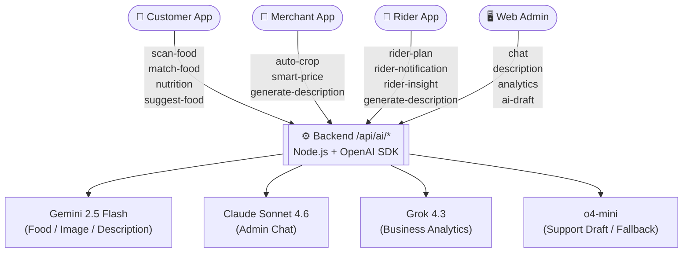

| โมเดล | ใช้กับ |
|-------|--------|
| **Gemini 2.5 Flash Lite** | วิเคราะห์รูปอาหาร, โภชนาการ |
| **Gemini 2.5 Flash** | สร้างคำอธิบาย, auto crop, ราคา |
| **Claude Sonnet 4.6** | Admin Chat Widget |
| **Grok 4.3** | Business Analytics |
| **o4-mini** | Support Draft Reply / fallback |

---

### 📱 Customer App — 4 AI Features

---

#### 1. Food Image Scanner (`POST /api/ai/scan-food`)

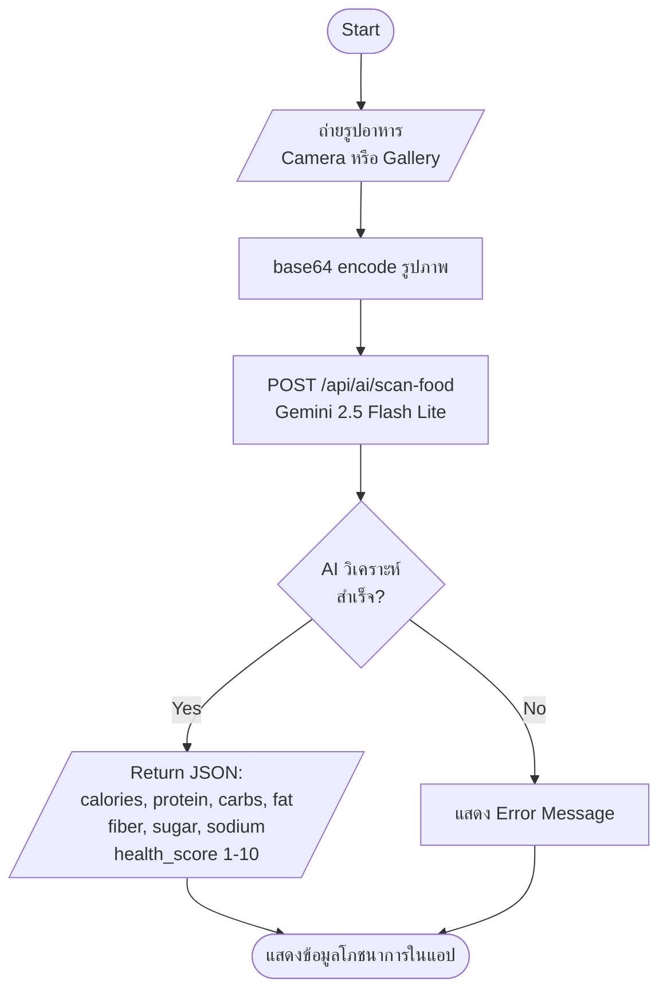

---

#### 2. Food Image Match (`POST /api/ai/match-food`)

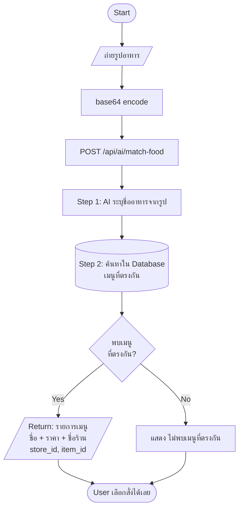

---

#### 3. Nutrition by Name (`POST /api/ai/nutrition-by-name`)

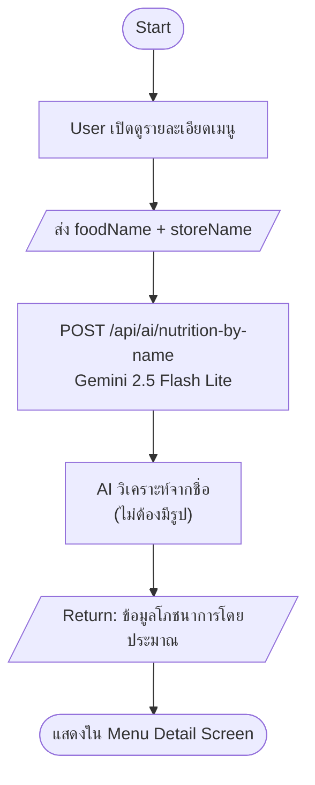

---

#### 4. Food Recommendation (`POST /api/ai/suggest-food`)

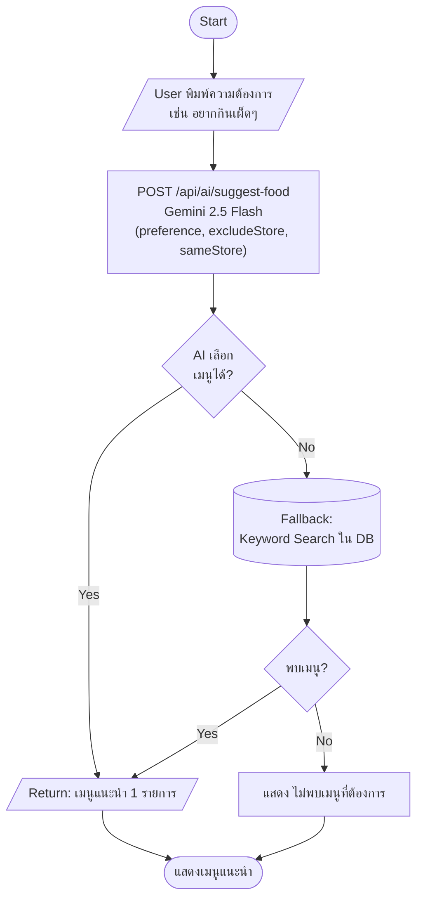

---

### 🏪 Merchant App — 3 AI Features

---

#### 5. Auto Crop Image (`POST /api/ai/auto-crop`)

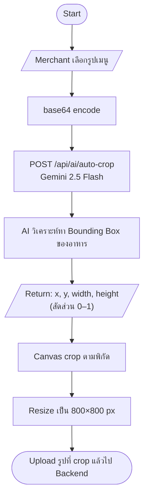

---

#### 6. Smart Price (`POST /api/ai/smart-price`)

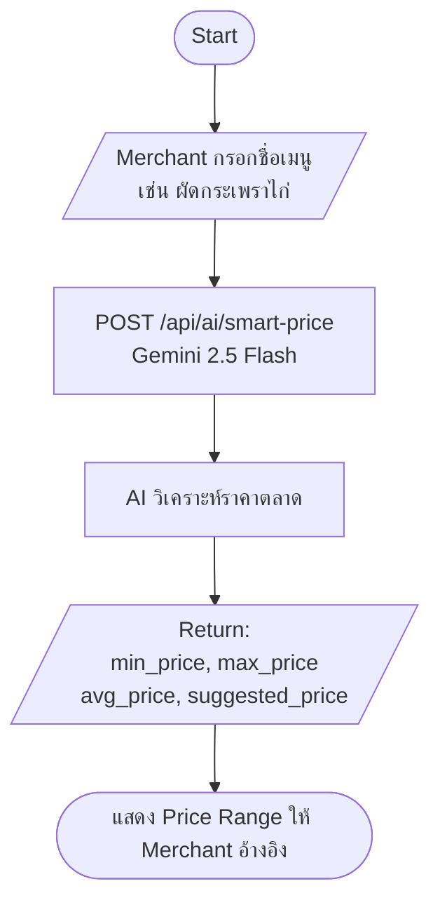

---

#### 7. Generate Description / Store Name (`POST /api/ai/generate-description`)

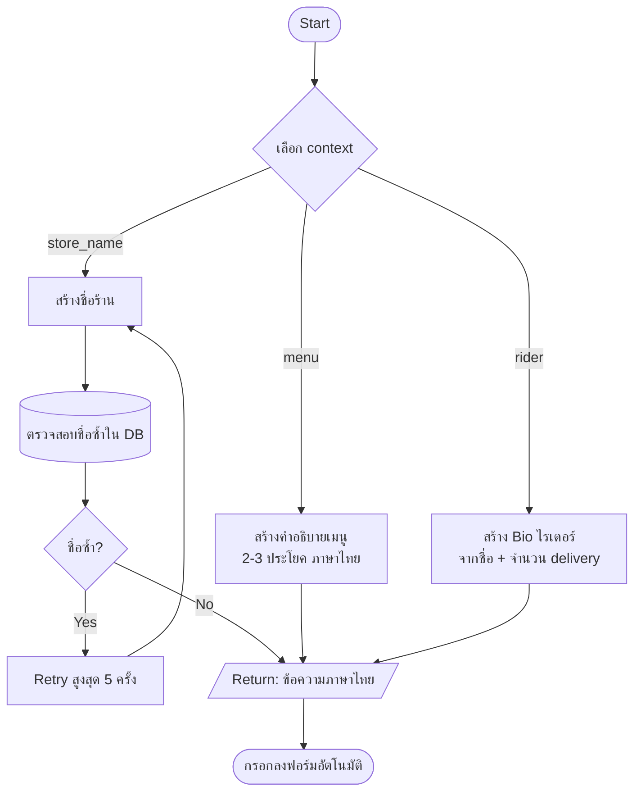

---

### 🚴 Rider App — 4 AI Features

---

#### 8. Rider Bio Generator

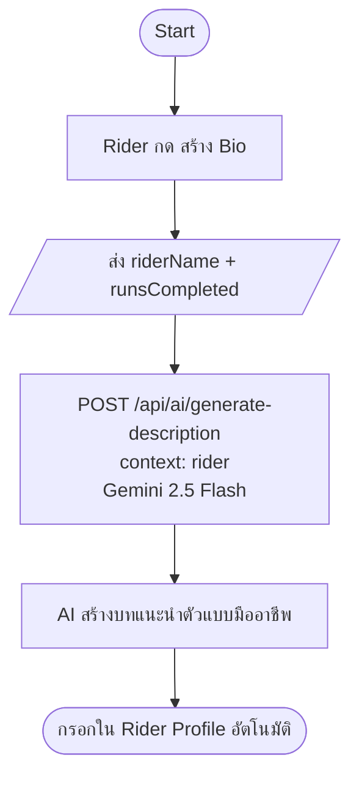

---

#### 9. Rider Daily Plan (`POST /api/ai/rider-plan`)

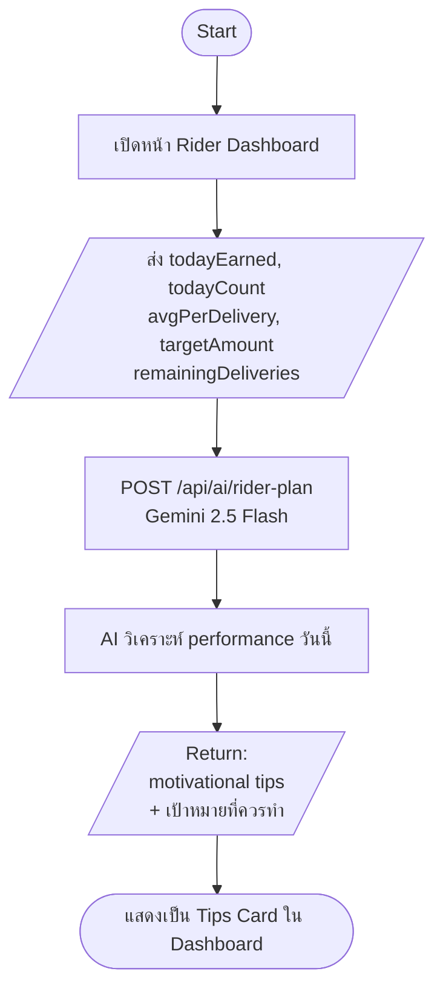

---

#### 10. Rider Notification Generator (`POST /api/ai/rider-notification`)

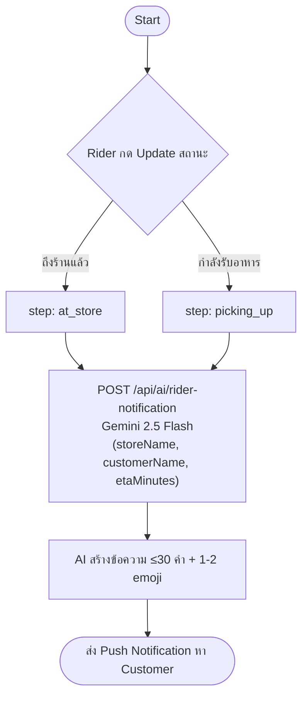

---

#### 11. Rider Insight & Analytics (`POST /api/ai/rider-insight`)

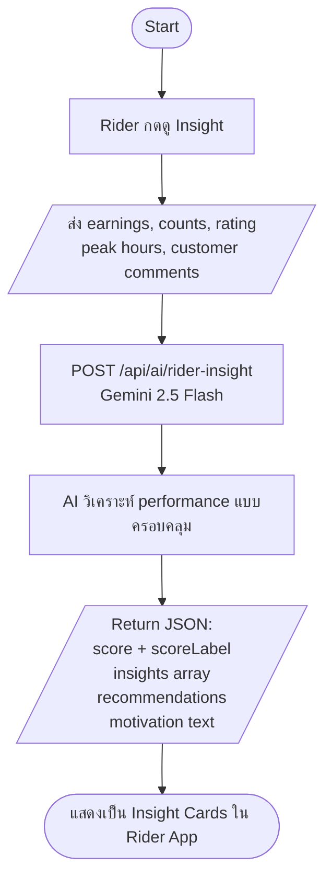

---

### 🖥️ Web Admin — 4 AI Features

---

#### 12. AI Chat Widget (`POST /api/ai/chat` — Streaming SSE)

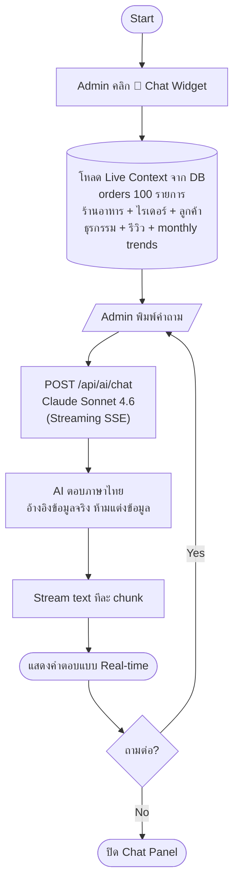

Suggested questions (built-in): "ยอดขายวันนี้เป็นอย่างไร?" / "ร้านไหนทำผลงานดีที่สุด?" / "ไรเดอร์คนไหน rating ต่ำสุด?"

---

#### 13. Restaurant Description Generator (`POST /api/ai/description`)

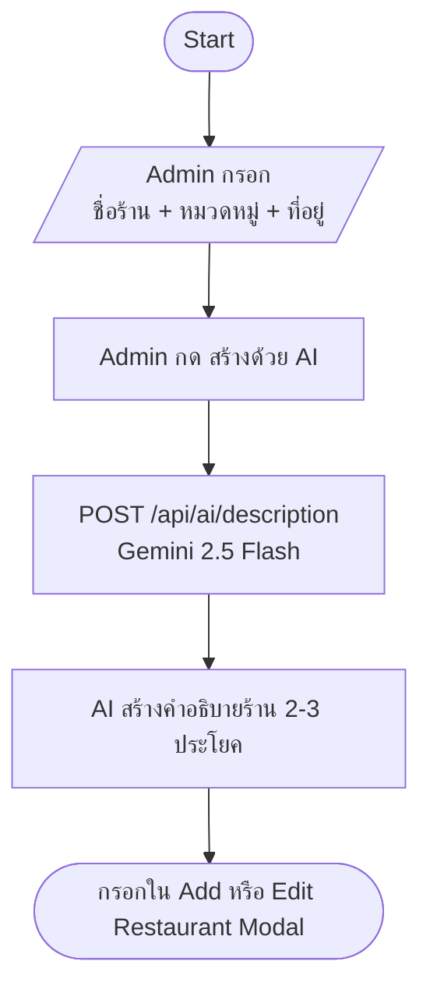

---

#### 14. Business Analytics & Planning (`POST /api/ai/analytics`)

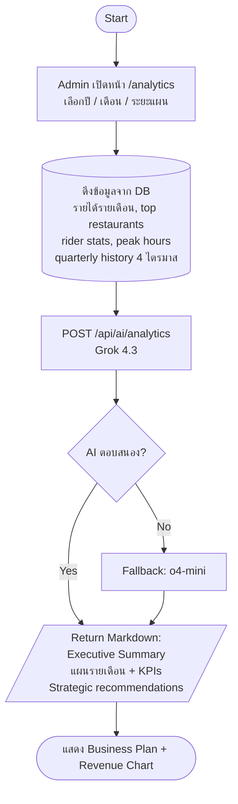

---

#### 15. Support Chat AI Draft Reply (`POST /api/support/[storeId]/ai-draft`)

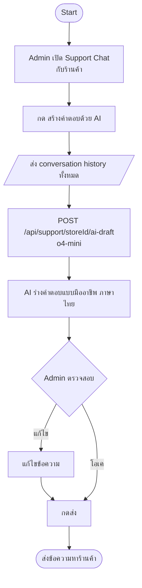

---

### สรุป AI Endpoints ทั้งหมด

| Endpoint | โมเดล | ใช้ใน |
|----------|-------|-------|
| `POST /api/ai/scan-food` | Gemini 2.5 Flash Lite | Customer App |
| `POST /api/ai/match-food` | Gemini 2.5 Flash Lite | Customer App |
| `POST /api/ai/nutrition-by-name` | Gemini 2.5 Flash Lite | Customer App |
| `POST /api/ai/suggest-food` | Gemini 2.5 Flash | Customer App |
| `POST /api/ai/auto-crop` | Gemini 2.5 Flash | Merchant + Web Admin |
| `POST /api/ai/smart-price` | Gemini 2.5 Flash | Merchant App |
| `POST /api/ai/generate-description` | Gemini 2.5 Flash | Merchant + Rider App |
| `POST /api/ai/rider-plan` | Gemini 2.5 Flash | Rider App |
| `POST /api/ai/rider-notification` | Gemini 2.5 Flash | Rider App |
| `POST /api/ai/rider-insight` | Gemini 2.5 Flash | Rider App |
| `POST /api/ai/chat` | Claude Sonnet 4.6 | Web Admin |
| `POST /api/ai/description` | Gemini 2.5 Flash | Web Admin |
| `POST /api/ai/analytics` | Grok 4.3 | Web Admin |
| `POST /api/support/[id]/ai-draft` | o4-mini | Web Admin |

> ⚙️ ต้องตั้งค่า `AI_BASE_URL`, `AI_MODEL`, `AI_ANALYTICS_MODEL`, `AI_DESCRIPTION_MODEL` ใน `.env.local`

---

## 🗄️ Database Schema

ชื่อ Database: `zest_savory`  
Character Set: `utf8mb4` (รองรับภาษาไทย + Emoji)

---

### 📊 ER Diagram (ความสัมพันธ์ระหว่าง Table)

```
┌─────────────────────────────────────────────────────────────────────────┐
│                                                                         │
│    ┌──────────┐   1     N  ┌───────────┐   1     N  ┌───────────────┐  │
│    │  users   │────────────│  stores   │────────────│menu_categories│  │
│    └──────────┘            └───────────┘            └───────────────┘  │
│                                  │                          │           │
│                                  │ 1                        │ 1         │
│                                  │                          │           │
│                              N   ▼                      N   ▼           │
│                          ┌────────────┐             ┌────────────────┐  │
│                          │  orders    │             │  menu_items    │  │
│                          └────────────┘             └────────────────┘  │
│                              │    │                                      │
│                        1     │    │ 1                                    │
│                              │    │                                      │
│                    N         ▼    ▼         N                            │
│             ┌─────────────┐    ┌──────────┐                             │
│             │ order_items │    │ earnings │                             │
│             └─────────────┘    └──────────┘                             │
│                                                                          │
│                          ┌──────────┐                                   │
│                          │ reviews  │                                   │
│                          └──────────┘                                   │
│                                                                         │
└─────────────────────────────────────────────────────────────────────────┘
```

---

### 👤 `users` — ผู้ใช้งานทั้งหมด

| คอลัมน์ | ชนิด | คำอธิบาย |
|---------|------|----------|
| `id` | INT PK | รหัสผู้ใช้ (Auto) |
| `phone` | VARCHAR(20) UNIQUE | เบอร์โทรศัพท์ (ใช้ Login) |
| `name` | VARCHAR(100) | ชื่อ-นามสกุล |
| `email` | VARCHAR(100) | อีเมล |
| `line_id` | VARCHAR(100) | LINE ID |
| `role` | ENUM | `customer` / `restaurant` / `rider` |
| `created_at` | TIMESTAMP | วันที่สมัคร |

---

### 🏪 `stores` — ข้อมูลร้านอาหาร

| คอลัมน์ | ชนิด | คำอธิบาย |
|---------|------|----------|
| `id` | INT PK | รหัสร้าน |
| `user_id` | INT FK → users | เจ้าของร้าน |
| `name` | VARCHAR(100) | ชื่อร้าน |
| `type` | VARCHAR(100) | ประเภทร้าน เช่น อาหารตามสั่ง |
| `address` | TEXT | ที่อยู่ร้าน |
| `lat` / `lng` | DECIMAL(10,7) | พิกัด GPS |
| `open_time` / `close_time` | VARCHAR(10) | เวลาเปิด-ปิด เช่น "08:00" |
| `is_open` | TINYINT(1) | เปิดร้านอยู่หรือไม่ |
| `image_url` | TEXT | รูปโลโก้ร้าน |
| `rating` | DECIMAL(2,1) | คะแนนเฉลี่ย 0-5 |
| `review_count` | INT | จำนวนรีวิว |
| `bank_name` | VARCHAR(100) | ธนาคารสำหรับรับเงิน |
| `account_name` | VARCHAR(100) | ชื่อบัญชี |
| `account_no` | VARCHAR(30) | เลขบัญชี |
| `id_card` | VARCHAR(20) | เลขบัตรประชาชน |
| `business_license` | VARCHAR(30) | เลขทะเบียนการค้า |
| `status` | ENUM | `pending` / `approved` / `rejected` |

---

### 📂 `menu_categories` — หมวดหมู่เมนู

| คอลัมน์ | ชนิด | คำอธิบาย |
|---------|------|----------|
| `id` | INT PK | รหัสหมวดหมู่ |
| `store_id` | INT FK → stores | เจ้าของหมวดหมู่ |
| `name` | VARCHAR(100) | ชื่อหมวด เช่น อาหารจานหลัก |
| `sort_order` | INT | ลำดับการแสดงผล |

> ⚠️ ถ้าลบ `stores` → `menu_categories` จะถูกลบตาม (CASCADE)

---

### 🍔 `menu_items` — รายการเมนูอาหาร

| คอลัมน์ | ชนิด | คำอธิบาย |
|---------|------|----------|
| `id` | INT PK | รหัสเมนู |
| `store_id` | INT FK → stores | ร้านเจ้าของเมนู |
| `category_id` | INT FK → menu_categories | หมวดหมู่ (nullable) |
| `name` | VARCHAR(100) | ชื่อเมนู |
| `description` | TEXT | คำอธิบาย |
| `price` | DECIMAL(10,2) | ราคา (บาท) |
| `image_url` | TEXT | URL รูปภาพอาหาร |
| `is_available` | TINYINT(1) | มีขายหรือหมดชั่วคราว |
| `sort_order` | INT | ลำดับแสดงผล |
| `created_at` | TIMESTAMP | วันที่เพิ่มเมนู |

> ⚠️ ถ้าลบหมวดหมู่ → `category_id` จะเป็น NULL (SET NULL)

---

### 🧾 `orders` — คำสั่งซื้อ

| คอลัมน์ | ชนิด | คำอธิบาย |
|---------|------|----------|
| `id` | INT PK | รหัส Order |
| `store_id` | INT FK → stores | ร้านที่รับออเดอร์ |
| `customer_id` | INT (nullable) | รหัสลูกค้า (อาจไม่มี) |
| `customer_name` | VARCHAR(100) | ชื่อลูกค้า |
| `customer_phone` | VARCHAR(20) | เบอร์ลูกค้า |
| `rider_id` | INT (nullable) | ไรเดอร์ที่รับงาน |
| `status` | ENUM | `pending` → `accepted` → `preparing` → `ready` → `delivering` → `completed` / `cancelled` |
| `total_amount` | DECIMAL(10,2) | ยอดรวมทั้งหมด |
| `delivery_fee` | DECIMAL(10,2) | ค่าจัดส่ง |
| `note` | TEXT | หมายเหตุจากลูกค้า |
| `address` | TEXT | ที่อยู่จัดส่ง |
| `created_at` | TIMESTAMP | เวลาสั่ง |
| `updated_at` | TIMESTAMP | อัปเดตล่าสุด |

#### 📌 Order Status Flow
```
┌──────────────────────── 📋 MERCHANT SIDE ──────────────────────────┐
│                                                                      │
│   pending ──[Accept]──► accepted ──[Start Cooking]──► preparing    │
│                                                            │         │
│                                                        [Finish]     │
│                                                            │         │
│                                                          ready      │
└────────────────────────────────────────────────────────────┼────────┘
                                                             │
┌──────────────────────── 🛵 DELIVERY SIDE ──────────────────┼────────┐
│                                                             ▼        │
│                                              [Start Delivery]        │
│                                                             │        │
│                                                        delivering   │
│                                                             │        │
│                                                          [Done]      │
│                                                             │        │
│                                                        completed ✅  │
└─────────────────────────────────────────────────────────────────────┘

  pending ──────────────────────────────────────────────────► cancelled ❌
```

| Tab | Status ที่แสดง |
|-----|----------------|
| **Active** | `pending`, `accepted`, `preparing` |
| **Delivery Queue** | `ready`, `delivering` |
| **Completed** | `completed` |
| **Cancelled** | `cancelled` |

---

### 🛒 `order_items` — รายการสินค้าในออเดอร์

| คอลัมน์ | ชนิด | คำอธิบาย |
|---------|------|----------|
| `id` | INT PK | รหัส |
| `order_id` | INT FK → orders | ออเดอร์ที่สังกัด |
| `menu_item_id` | INT (nullable) | รหัสเมนูต้นฉบับ |
| `name` | VARCHAR(100) | ชื่อเมนูตอนสั่ง (snapshot) |
| `price` | DECIMAL(10,2) | ราคาตอนสั่ง (snapshot) |
| `quantity` | INT | จำนวน |
| `note` | TEXT | หมายเหตุเพิ่มเติม |

> 💡 `name` และ `price` เก็บ snapshot ไว้ เพื่อให้ข้อมูลไม่เปลี่ยนแม้จะแก้เมนูภายหลัง

---

### 💰 `earnings` — รายได้ร้านค้า

| คอลัมน์ | ชนิด | คำอธิบาย |
|---------|------|----------|
| `id` | INT PK | รหัส |
| `store_id` | INT FK → stores | ร้านที่ได้รับรายได้ |
| `order_id` | INT FK → orders | ออเดอร์ที่เกี่ยวข้อง |
| `amount` | DECIMAL(10,2) | จำนวนเงิน (หลังหักค่าบริการ 15%) |
| `type` | ENUM | `order` / `adjustment` / `payout` |
| `status` | ENUM | `pending` (รอโอน) / `paid` (โอนแล้ว) |
| `created_at` | TIMESTAMP | วันที่บันทึก |

---

### ⭐ `reviews` — รีวิวจากลูกค้า

| คอลัมน์ | ชนิด | คำอธิบาย |
|---------|------|----------|
| `id` | INT PK | รหัสรีวิว |
| `store_id` | INT FK → stores | ร้านที่ถูกรีวิว |
| `customer_id` | INT (nullable) | รหัสลูกค้า |
| `customer_name` | VARCHAR(100) | ชื่อลูกค้า |
| `order_id` | INT (nullable) | ออเดอร์ที่รีวิว |
| `rating` | INT (1-5) | คะแนน ⭐⭐⭐⭐⭐ |
| `comment` | TEXT | ความคิดเห็น |
| `reply` | TEXT | คำตอบจากร้าน |
| `created_at` | TIMESTAMP | วันที่รีวิว |

---

## 🔗 Foreign Key Summary

```
stores.user_id          → users.id
menu_categories.store_id → stores.id  (CASCADE DELETE)
menu_items.store_id      → stores.id  (CASCADE DELETE)
menu_items.category_id   → menu_categories.id  (SET NULL)
orders.store_id          → stores.id
order_items.order_id     → orders.id  (CASCADE DELETE)
earnings.store_id        → stores.id
earnings.order_id        → orders.id
reviews.store_id         → stores.id
```

---

## 🛠️ Tech Stack

| Layer | Technology |
|-------|-----------|
| **Frontend** | Flutter (Dart) |
| **Backend** | Node.js + Express.js |
| **Database** | MySQL 8+ |
| **Auth** | Firebase Phone Authentication |
| **Image Storage** | Local Server (`/public/uploads`) |
| **HTTP Client** | `package:http` |

---

## 🚀 Getting Started

### 1. Start Database
```bash
mysql -u root -p < backend/schema.sql
```

### 2. Start Backend
```bash
cd backend
node server.js
# Server runs on http://localhost:3000
```

### 3. Start Flutter App
```bash
cd merchantapp
flutter run -d chrome
```
# Merchant App
cd merchantapp
flutter run -d chrome --web-port 8080

# Customer App
cd customerapp
flutter run -d chrome --web-port 8081

# Rider App
cd riderapp
flutter run -d chrome --web-port 8082

cd backend
npm start
# หรือ dev mode (auto-reload)
npm run dev
